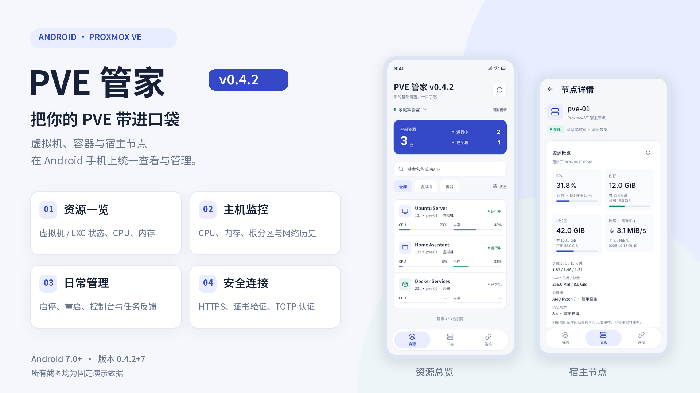
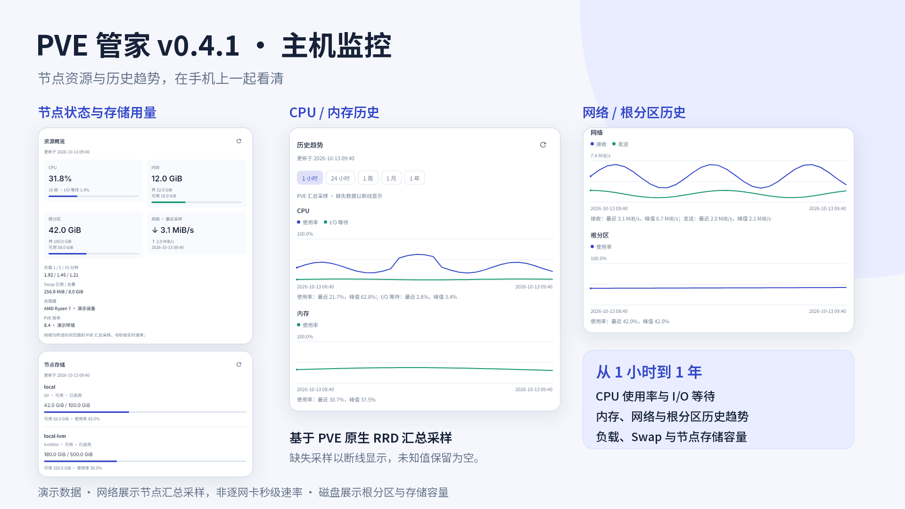
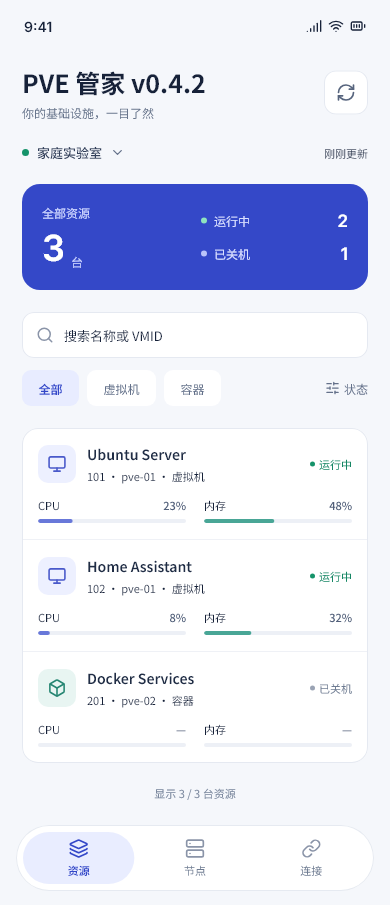
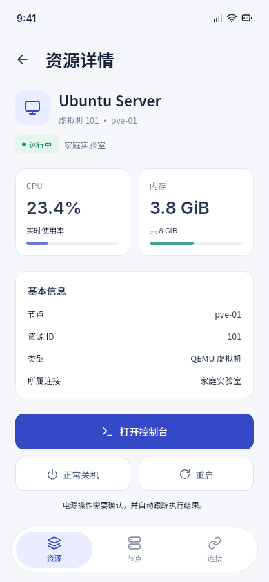
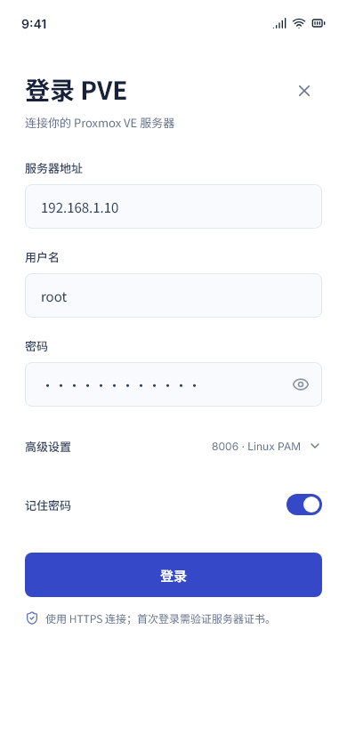

# PVE 管家

在 Android 手机上查看 Proxmox VE 资源、管理虚拟机与容器，并了解宿主机的资源使用情况。

PVE 管家是面向 Proxmox VE 8/9 的第三方客户端，提供中文界面、多连接管理、资源电源操作和 PVE 自带的远程控制台。当前版本为 **0.4.1+6**，适用于 **Android 7.0 及以上**。

[下载安装包](https://github.com/sanduo-656/pve-manager/releases/tag/v0.4.1) · [本版更新](docs/release-v0.4.1.md) · [介绍文字稿](docs/project-introduction.md) · [PVE 账号与权限配置](docs/pve_setup.md)



## 可以做什么

| 功能 | 说明 |
| --- | --- |
| 多连接管理 | 保存、编辑和切换多个 PVE 服务器或集群入口 |
| 资源概览 | 查看 QEMU 虚拟机、LXC 容器的状态、CPU、内存、节点和 ID |
| 资源操作 | 开机、正常关机、重启，并跟踪 PVE 任务结果 |
| 远程控制台 | QEMU 使用 PVE noVNC，LXC 使用 PVE xterm.js |
| 节点监控 | CPU、I/O 等待、负载、内存、Swap、根分区、网络及存储容量 |
| 历史趋势 | 切换 1 小时、24 小时、周、月和年，查看节点历史采样 |
| 节点电源管理 | 关机或重启前输入完整节点名确认，功能受 PVE 权限控制 |
| 登录与证书 | 账号密码、TOTP、会话续期，以及 SHA-256 证书指纹确认 |

## 节点监控



监控读取 PVE 自带的 `status`、`rrddata` 和 `storage` 接口，无需在宿主机安装额外采集程序。节点详情展示当前资源概况、历史趋势、存储容量及数据更新时间。

- **CPU 与负载**：CPU 使用率、I/O 等待及系统负载。
- **内存**：内存和 Swap 的使用情况。
- **磁盘容量**：根分区使用量，以及当前节点各 PVE 存储的容量与可用状态。
- **网络**：节点汇总的接收、发送速率及历史趋势，数据单位为 B/s，界面自动换算。

网络概览使用所选时间范围内最新的 PVE RRD 采样，并显示采样时间；它不等同于逐网卡实时抓取。历史精度由 PVE 及所选时间范围决定。磁盘监控目前以容量为主，未提供每块物理磁盘的 IOPS、延迟或 SMART 健康信息，也未提供 CPU 温度、应用关闭后的持续监控或告警。

前台仅轮询当前查看的节点：状态约每 15 秒刷新，历史与存储列表最多每分钟自动请求一次，手动刷新可立即更新。退到后台或离开节点详情后停止监控轮询。缺失指标显示未知，缺失采样保留曲线断点；请求失败会提示错误，并保留上次成功数据与更新时间。

## 界面预览

<p>
  
  
  
</p>

介绍图片和界面截图使用演示数据。实际资源名称、状态、数量及监控值由连接的 PVE 返回。

## 下载与使用

从 [GitHub Releases](https://github.com/sanduo-656/pve-manager/releases/tag/v0.4.1) 下载 `PVE-Manager-0.4.1+6-release.apk`，同时下载 `SHA256SUMS.txt` 可核对安装包。当前包约 64.4 MiB，包含 arm64-v8a、armeabi-v7a 和 x86_64。

同一发布页提供完整源码压缩包和介绍素材包。素材包包含中文介绍稿、两张 1920×1080 介绍图、界面截图和账号配置指南。

当前 APK 使用内部测试签名，适合测试与体验；尚未作为正式商店签名版本发布。版本号显示在应用内首页，桌面名称保持“PVE 管家”。

1. 按 [配置指南](docs/pve_setup.md) 为应用创建专用账号并授予所需权限。
2. 打开应用，输入 PVE 主机名或 IP，不包含 `https://`、路径或端口。
3. 输入用户名与密码。“高级设置”默认端口为 `8006`、认证域为 `pam`，可改为 `pve` 或自定义认证域。
4. 使用自签名证书时，通过可信管理终端核对应用显示的 SHA-256 指纹后再确认。账号开启 TOTP 时，按提示输入验证码。
5. 登录后在“资源”“节点”“连接”之间切换；查看节点监控前确认账号拥有对应读取权限。

用户名可以填 `root` 并选择 `pam`，或直接填 `root@pam`。例如使用 PVE 认证域的专用账号时，可填 `pvemanager` 并选择 `pve`，也可直接填 `pvemanager@pve`。**用户名已包含 `@认证域` 时，以用户名中的认证域为准。** 新建连接默认不记住密码；开启“记住密码”后，密码通过 Android 安全存储保存。

## 权限与连接安全

应用根据 PVE 账号权限显示数据和操作入口。资源查看、控制台、电源管理，以及节点和存储读取需要不同权限；具体角色和 `pveum` 命令见 [PVE 配置指南](docs/pve_setup.md)。仅查看节点监控时，可单独授予 `Sys.Audit` 和所需存储的 `Datastore.Audit`，无需授予电源权限。

连接只使用 HTTPS。支持系统可信证书，也支持用户核对后固定自签名证书的 SHA-256 指纹；指纹发生变化时阻断连接，重新核对后才能更新。Ticket、CSRF Token 和 TOTP challenge 仅保存在内存，TOTP 密钥和验证码不会保存。控制台会话 Cookie 在退出时清除。

“关机”调用 PVE 的正常关机接口，超时后不会自动改为强制停止。节点电源请求超时后不会自动重放。建议通过管理局域网或 VPN 访问 PVE，并使用专用账号按需授权。

## 当前验证情况与限制

0.4.1+6 已通过静态分析、**150 项自动化测试**、Release APK 签名与对齐检查，以及 Android API 36 模拟器安装和启动验证。自动化测试覆盖 API 解析、会话与证书处理、节点监控刷新、缓存及错误状态，以及界面布局和交互。

新增节点监控在真实 PVE 8/9 上的字段、采样精度和权限表现仍需进一步验证。自动化测试与演示截图不能替代目标设备上的控制台、TOTP、长期会话及电源操作验证。遇到问题时，请在 [Issues](https://github.com/sanduo-656/pve-manager/issues) 提供应用版本、Android/PVE 版本、复现步骤及脱敏后的错误信息。

已知使用限制：

- Android 7–9 的 WebView 在无法读取证书 DER 数据时会拒绝自签名控制台连接，需使用受信任证书链；不会降级为忽略证书错误。
- QEMU 仅直通物理 GPU 且没有虚拟显示设备时，noVNC 可能没有画面，需通过客户机内的 RDP/VNC 等方式连接。
- 当前客户端提供管理与前台监控，不包含 VPN 隧道、备份编排或后台告警服务。

## 开发与构建

开发环境基线：Flutter 3.41.7、Dart 3.11.5、Java 17+；Android min SDK 24，compile/target SDK 36。发布脚本适用于 Windows PowerShell。

```powershell
flutter pub get
dart run tool/sync_app_version.dart --check
flutter analyze
flutter test
.\tool\build_release.ps1
```

版本由 `pubspec.yaml` 管理。修改后执行 `dart run tool/sync_app_version.dart` 同步应用内显示；发布脚本会自动同步，再生成 `dist\PVE-Manager-<版本>-release.apk` 和 `dist\SHA256SUMS.txt`。输出目录只保留当前版本的 APK，也可用 `-OutputDirectory` 指定其他目录。

脚本在系统临时目录的 ASCII 路径构建副本，以兼容 Windows 上 Flutter AOT 工具对中文项目路径的限制，并排除本地索引及构建缓存。构建完成后清理副本。

界面与设备验收：

```powershell
flutter test test/presentation/rt2w7_acceptance_test.dart
flutter devices
$deviceId = '填写设备 ID'
flutter test integration_test/app_smoke_test.dart -d $deviceId
flutter drive --driver=test_driver/ui_acceptance_driver.dart --target=integration_test/ui_acceptance_test.dart -d $deviceId
```

界面验收使用固定演示数据，不连接真实 PVE，也不执行电源操作。截图默认导出到 `docs/screenshots`，可用 `PVE_SCREENSHOT_DIR` 环境变量指定其他目录。

## 反馈

欢迎通过 [Issues](https://github.com/sanduo-656/pve-manager/issues) 反馈问题或提出功能需求。请勿提交密码、Ticket、验证码或未脱敏的管理网络信息。

PVE 管家是独立的第三方项目，与 Proxmox Server Solutions GmbH 无隶属关系。

## 授权说明

项目当前尚未指定整体开源许可证。随项目分发的字体和图标各有授权文件：[Noto Sans SC / SIL OFL](assets/fonts/OFL.txt)、[Inter / SIL OFL](assets/fonts/Inter-OFL.txt)、[Lucide 图标授权](assets/icons/LICENSE)。第三方组件的授权以各组件声明为准。
